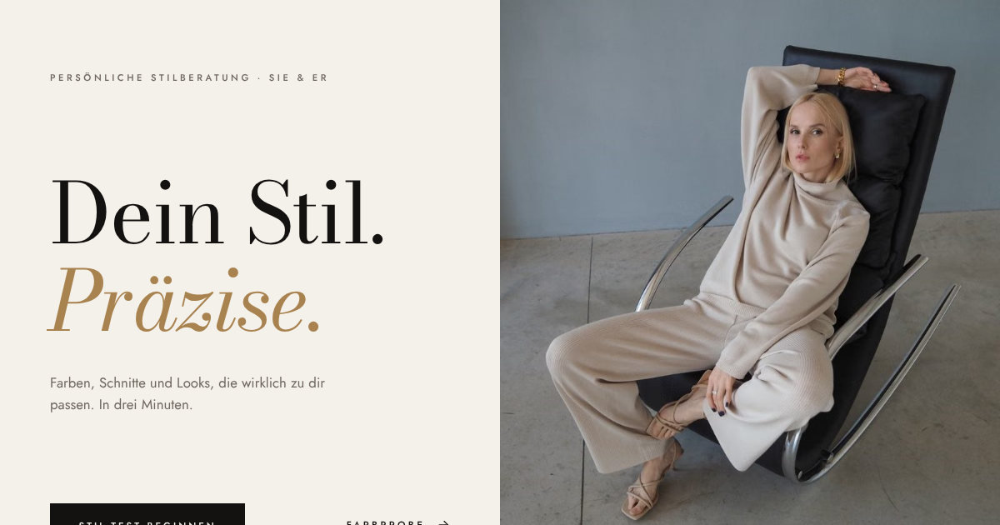

# Stylemaker

**Konzept-Prototyp einer Styling-App für Frauen und Männer: Farbtyp, Figur, Stil-Test, Farbprobe mit Foto, Outfits und Trends, auf Deutsch, Rumänisch und Englisch.**

[Prototyp ansehen →](https://dandelion1111r.github.io/stylemaker/)

## Funktionen

| Bereich | Was er zeigt |
| --- | --- |
| Stil-Test | 13 Fragen zu Haut, Haar, Augen, Kontrast, Figur, Größe (Gewicht freiwillig) und Stil, danach Farbtyp, Figur, Basis-Garderobe, Accessoires und passende Trends |
| Farbtypen | Frühling, Sommer, Herbst, Winter mit je 8 besten Farben, 4 Basisfarben, Metall und Farben zum Meiden, Vorschau am Kragen |
| Figur | 5 Figurtypen, getrennt für Frauen und Männer, mit Silhouette, Ziel, passenden Schnitten und Accessoires |
| Farbprobe | Eigenes Foto neben einer besten und einer ungünstigen Farbe vergleichen, wie bei einer Farbberatung mit Tüchern. Das Foto verlässt den Browser nicht |
| Looks | 5 Anlässe × 3 Wetterlagen, komplett mit Schuhen, Tasche und Schmuck, in den Farben des Profils, mit Begründung |
| Trends | 11 Trends Herbst/Winter 2026/27, bewertet für das eigene Profil: passt direkt oder mit Anpassung |

## Gestaltung

Editorialer Luxus-Look: Elfenbein, Tinte und ein Champagner-Akzent, große Fotografie mit echten Menschen, sehr wenig Text.

## Technik

- Kurze Landingpage (`index.html`) und eigene App (`app.html`) mit Heute, Stilformel, Looks, Garderobe und Check
- HTML, CSS und JavaScript, ohne Framework und ohne Build-Schritt
- Sprachumschalter Deutsch / Rumänisch / Englisch, Auswahl bleibt im Browser gespeichert
- Installierbar als Web-App (PWA), funktioniert auch offline
- Angepasst für Smartphone und Desktop
- Schriften lokal eingebunden, keine Cookies, kein Tracking

Lokal ansehen: `index.html` im Browser öffnen.

## Hinweise

Stylemaker ist ein Konzept-Prototyp und keine echte App. Es werden keine Daten übertragen. Die Empfehlungen sind allgemeine Stilregeln und ersetzen keine persönliche Beratung.

## Credits

Konzept und Design: Raluca Jidvian, 2026.
Schriftarten: Bodoni Moda, Jost, DM Mono (SIL Open Font License, siehe `fonts/`).
Fotos: Pexels (Pexels-Lizenz), von Nadin Sh, Criativa Pix Fotografia, Warona Rasetshwane, Alena Evseenko, Shiny Diamond, Thang Nguyen, Gursher Gill, Leszek Czyzewski, Karolina Ostrzolek, Atlantic Ambience.

Trends (Stand November 2026): Herbst/Winter 2026 und Frühjahr/Sommer 2027 nach Laufsteg-Berichten von Coveteur, W Magazine, Net-a-Porter, InStyle, Numéro, Who What Wear und FashionUnited. Die Trendfarben werden automatisch auf die Palette jedes Farbtyps übertragen.

Stoffmuster der Look-Karten (`img/tex/`, Pexels-Lizenz, in Graustufen umgewandelt und in der Farbe jedes Teils eingefärbt): [Strick](https://www.pexels.com/photo/6843269/), [Seide](https://www.pexels.com/photo/7946623/), [Leinen](https://www.pexels.com/photo/8774406/), [Köper/Denim](https://www.pexels.com/photo/10912871/), [Leder](https://www.pexels.com/photo/6045262/), [Metall](https://www.pexels.com/photo/35058966/).
Trendquellen: Who What Wear, Harrods, FashionUnited, Net-a-Porter, H&M, The Wed.
